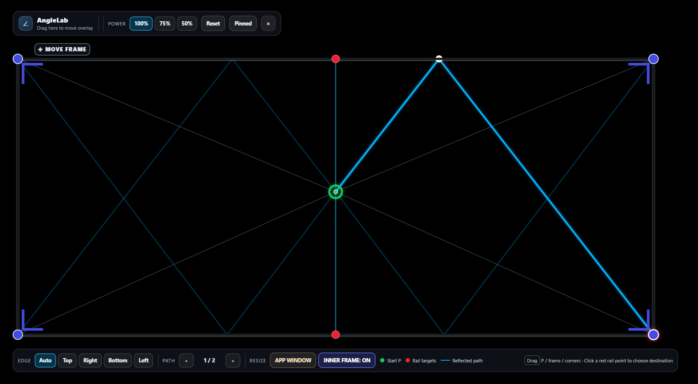
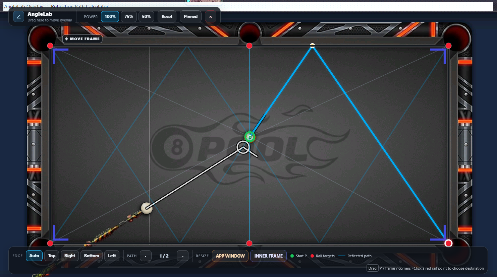

# AngleLab

A pool angle calculator and trajectory visualization tool designed to help players understand and visualize cue-ball paths and cushion shots.

## Features

- Pool angle calculations
- Cushion path visualization
- Multiple path options
- Visual trajectory planning
- Simple and intuitive interface

## Platform

Windows

## Installation

1. Download the application from the Releases section.
2. Extract the downloaded ZIP file.
3. Open the application folder.
4. Run `AngleLab Overlay.exe`.

## Project Status

Currently under development.

## Feedback and Contributions

Bug reports, suggestions, and contributions are welcome.

## Screenshots

### Main Interface

### Path Visualization

